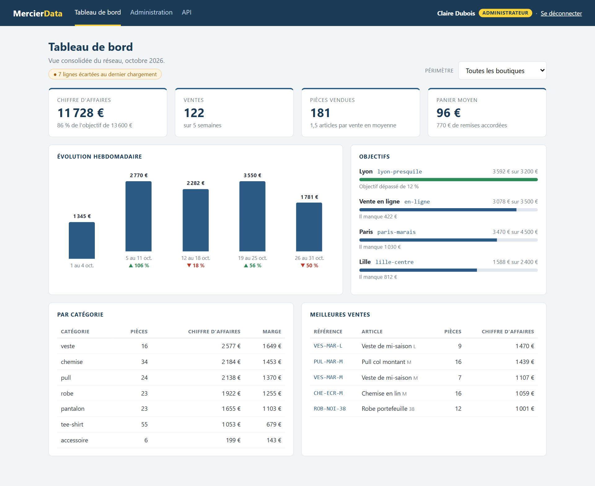
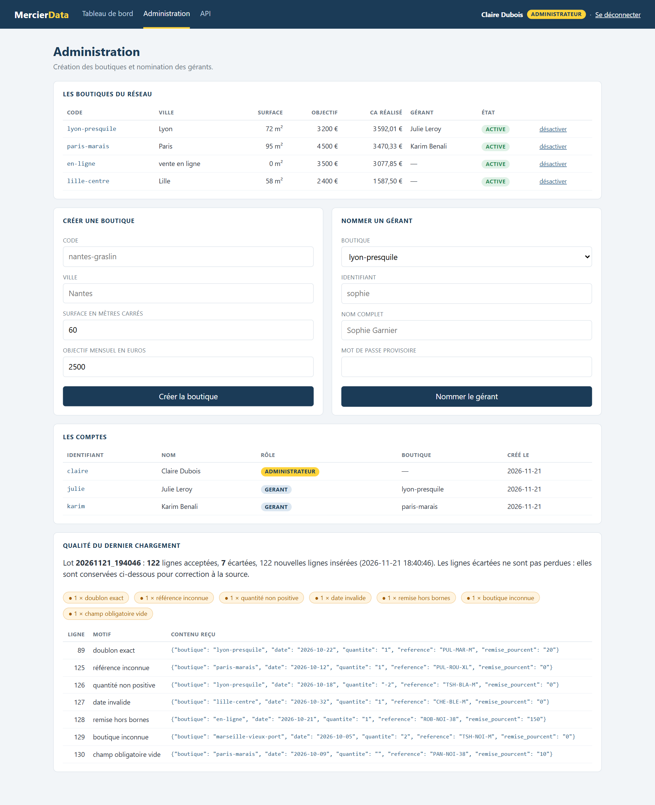

# Mercier Data

Plateforme de données d'**Atelier Mercier**, une marque de vêtements fictive : elle ingère les fichiers produits chaque nuit par les caisses et le site de vente, contrôle leur qualité, les charge dans un entrepôt en étoile et les restitue dans un tableau de bord web et une API JSON, avec des droits d'accès cloisonnés par boutique.



> Projet réalisé dans le cadre du cours *Notions Python avancées* (Master 1 DAT).

## Sommaire

- [Fonctionnalités](#fonctionnalités)
- [Architecture](#architecture)
- [Prérequis](#prérequis)
- [Installation](#installation)
- [Utilisation](#utilisation)
- [Routes](#routes)
- [Configuration](#configuration)
- [Tests](#tests)
- [Déploiement avec Docker](#déploiement-avec-docker)
- [Structure du projet](#structure-du-projet)

## Fonctionnalités

- **Ingestion** : copie horodatée des fichiers reçus dans une zone brute, empreinte SHA-256 et manifeste de livraison. La donnée reçue n'est jamais modifiée.
- **Contrôle qualité** : six familles de contrôles (champs obligatoires, dates, référence, boutique, bornes numériques, doublons). Les lignes fautives sont écartées, tracées avec leur motif et conservées pour correction.
- **Entrepôt en étoile** (SQLite) : une table de faits et trois dimensions, mises à jour par UPSERT. Le chargement est **transactionnel** et **idempotent** : relancer la chaîne n'insère aucun doublon.
- **Interfaçage Java** : la règle de remise, écrite en Java, est appelée via JPype, ou à défaut par sous-processus, avec un repli Python automatique si aucune JVM n'est disponible.
- **Tableau de bord web** (FastAPI + Jinja2) : chiffre d'affaires, ventes, panier moyen, évolution hebdomadaire, objectifs par boutique, catégories, meilleures ventes.
- **API JSON** documentée automatiquement sur `/docs`.
- **Sécurité** : mots de passe hachés (PBKDF2-SHA256, sel unique, 200 000 itérations, comparaison en temps constant), session signée, rôles `administrateur` et `gerant`. Le **cloisonnement** est appliqué dans les requêtes SQL : un gérant ne voit que sa boutique, par aucun chemin.
- **Administration** : création de boutiques, nomination des gérants, désactivation sans perte d'historique.
- **Mise en production** : image Docker avec JDK, volume persistant, point de santé et refus de démarrer avec la clé secrète de développement.

## Architecture

```text
fichiers reçus      zone brute         entrepôt            restitution
--------------      ----------         --------            -----------
articles.csv    -+
ventes.csv       +-> ingestion -> qualité -> modèle     -> API JSON
boutiques.json   |   (copie       (contrôles  en étoile     et tableau
journal.log     -+   horodatée)   et rejets)  SQLite        de bord
                                      |
                               moteur de remises
                               (composant Java)
```

| Module | Rôle |
| --- | --- |
| `config.py` | Configuration lue dans l'environnement |
| `ingestion.py` | Zone brute horodatée, empreintes, manifeste |
| `qualite.py` | Contrôles, classe `Rejet`, rapport chiffré |
| `entrepot.py` | Schéma en étoile, UPSERT, idempotence, transaction |
| `tarif_java.py` | Trois voies vers le moteur Java, repli automatique |
| `indicateurs.py` | Requêtes de restitution, toutes cloisonnées |
| `securite.py` | Hachage, authentification, rôles, cloisonnement |
| `administration.py` | Boutiques et gérants, validation métier |
| `api.py` | Routes, dépendances, templates, API JSON |
| `cli.py` | Ligne de commande |

## Prérequis

- **Python 3.14** (version utilisée et testée)
- **JDK 21**, facultatif : sans Java, le calcul des remises bascule sur une implémentation Python équivalente
- **Docker**, facultatif, pour le déploiement

## Installation

```bash
git clone <url-du-depot>
cd mercier_data

python -m venv .venv
.venv\Scripts\activate            # Windows
source .venv/bin/activate         # Linux et macOS

pip install -r requirements.txt
javac java/Tarif.java             # facultatif, si un JDK est installé
```

## Utilisation

Toutes les commandes se lancent depuis la racine du projet, le dossier qui contient `mercier/`.

### 1. Charger les données

```bash
python -m mercier.cli chaine
```

```text
Lot 20261118_200000 : 4 fichiers reçus
Contrôle : 122 acceptées, 7 rejetées (94.57 pour cent)
Moteur tarifaire : jpype
Chargement : 122 nouvelles lignes de faits
```

| Commande | Effet |
| --- | --- |
| `python -m mercier.cli config` | Affiche la configuration effective |
| `python -m mercier.cli ingerer` | Copie les fichiers reçus dans un nouveau lot |
| `python -m mercier.cli controler [lot]` | Rapport qualité d'un lot, sans le charger |
| `python -m mercier.cli chaine` | Ingestion, contrôle et chargement |
| `python -m mercier.cli rejouer <lot>` | Recharge un lot déjà ingéré |
| `python -m mercier.cli creer-admin <identifiant> "<nom>"` | Crée un compte administrateur |

### 2. Créer le premier administrateur

```bash
python -m mercier.cli creer-admin claire "Claire Dubois"
```

Le mot de passe (8 caractères minimum) est demandé au clavier. Les gérants se nomment ensuite depuis la page **Administration**.

### 3. Lancer l'application

```bash
uvicorn mercier.api:app --reload
```

Puis ouvrir <http://127.0.0.1:8000>. La documentation interactive de l'API est sur <http://127.0.0.1:8000/docs>.



## Routes

Les pages redirigent vers `/connexion` sans session (303). L'API répond 401 sans session et 403 si le rôle ne suffit pas. Les formulaires répondent toujours par une redirection 303 (motif *envoyer, rediriger, afficher*).

| Méthode | Route | Accès | Description |
| --- | --- | --- | --- |
| GET / POST | `/connexion` | public | Formulaire et validation de la connexion |
| GET | `/deconnexion` | public | Fin de session |
| GET | `/` | connecté | Tableau de bord, filtre `?boutique=<code>` |
| GET | `/administration` | administrateur | Boutiques, gérants, comptes, qualité du dernier lot |
| POST | `/administration/boutique` | administrateur | Création d'une boutique |
| POST | `/administration/gerant` | administrateur | Nomination d'un gérant |
| POST | `/administration/boutique/{code}/etat` | administrateur | Désactivation ou réactivation |
| GET | `/api/synthese` | connecté | Ventes, pièces, CA, panier moyen, remises |
| GET | `/api/boutiques` | connecté | CA par boutique face à l'objectif |
| GET | `/api/categories` | connecté | CA et marge par catégorie |
| GET | `/api/meilleures` | connecté | Références les plus rentables |
| GET | `/api/evolution` | connecté | CA par semaine |
| GET | `/api/qualite` | administrateur | Dernier chargement et rejets |
| GET | `/sante` | public | Point de santé pour la supervision |

## Configuration

La configuration est lue dans les variables d'environnement. Un modèle est fourni dans [`.env.exemple`](.env.exemple). Le fichier `.env` réel n'est jamais versionné.

| Variable | Défaut | Rôle |
| --- | --- | --- |
| `MERCIER_SOURCES` | `./donnees_sources` | Dossier des fichiers reçus |
| `MERCIER_ZONE_BRUTE` | `./zone_brute` | Dossier des lots ingérés |
| `MERCIER_ENTREPOT` | `./entrepot.db` | Base SQLite |
| `MERCIER_JAVA` | `./java` | Classes Java compilées |
| `MERCIER_CLE_SECRETE` | clé de développement | Signature des sessions, **à changer en production** |
| `MERCIER_ENV` | `developpement` | `production` active les cookies HTTPS et le contrôle de la clé |
| `MERCIER_TVA` | `0.20` | Taux de TVA |

Pour engendrer une clé secrète :

```bash
python -c "import secrets; print(secrets.token_urlsafe(48))"
```

## Tests

```bash
python -m pytest
```

Les 22 tests portent sur l'ingestion, les sept rejets attendus, l'idempotence, la concordance des voies tarifaires, le hachage des mots de passe, la validation métier et le cloisonnement de bout en bout (pages, API et paramètres d'adresse). Chaque test travaille sur une base temporaire et ne touche jamais à la vraie.

## Déploiement avec Docker

```bash
docker build -t mercier-data .

docker run -d --name mercier -p 8000:8000 \
    -v mercier_donnees:/donnees \
    -e MERCIER_CLE_SECRETE="<valeur aléatoire longue>" \
    mercier-data

docker exec mercier python -m mercier.cli chaine
docker exec -it mercier python -m mercier.cli creer-admin claire "Claire Dubois"
```

L'image embarque Python 3.14 et un JDK 21. La base vit sur le volume `/donnees`, l'application tourne sous un utilisateur non privilégié et Docker surveille `/sante` via `HEALTHCHECK`.

## Structure du projet

```text
mercier_data/
├── donnees_sources/        fichiers reçus (jeu de démonstration, voir ci-dessous)
├── java/Tarif.java         moteur de remises, composant fourni
├── mercier/                paquet de l'application
│   ├── templates/          pages HTML (Jinja2)
│   └── static/             feuille de style
├── tests/                  tests pytest
├── docs/captures/          captures d'écran
├── Dockerfile
├── requirements.txt
├── pytest.ini
└── .env.exemple
```

Les dossiers `zone_brute/` et `entrepot.db` sont produits par la chaîne et exclus du dépôt : `python -m mercier.cli chaine` les reconstruit.

### Jeu de données

`donnees_sources/` contient un mois de ventes (129 lignes, octobre 2026) pour quatre boutiques et un catalogue de 18 références. Six lignes fautives y ont été ajoutées volontairement, une par type de contrôle, et une septième (un doublon) était déjà présente : la chaîne doit en rejeter exactement sept.
